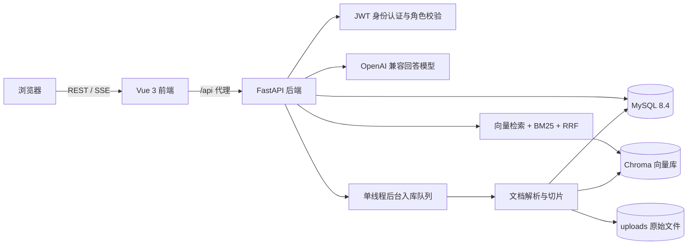
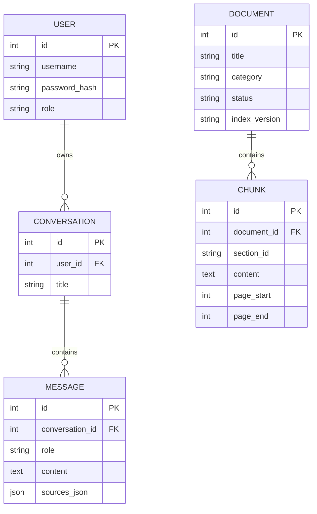

# 校园智能问答系统

基于 FastAPI、Vue 3 和 MySQL 的校园知识库问答系统。项目支持多格式文档入库、向量与 BM25 混合检索、引用校验、多轮对话，以及本地或 OpenAI 兼容远程大模型。

当前版本面向单机演示和毕业设计验证，默认只监听本机地址，不包含模型文件、业务数据库或真实校园文档。

## 功能

- Vue 3、TypeScript、Vite、Element Plus 和 Pinia 前端
- FastAPI、SQLAlchemy 2.x 和 MySQL 8.4 后端
- Argon2id 密码哈希、JWT 身份认证和管理员权限控制
- PDF、DOCX、XLSX、CSV、TXT、Markdown 文档解析与切片
- BGE-small 与 Qwen3-Embedding 双向量索引
- 向量检索、中文 BM25 和 RRF 融合排序
- SSE 流式问答、多轮问题改写和引用来源校验
- 本地模型与 OpenAI 兼容远程模型配置切换
- 后端自动化测试和前端生产构建检查

角色与主要能力：

| 角色 | 主要能力 |
| --- | --- |
| 学生 | 注册、登录、创建会话、多轮问答、查看回答引用 |
| 管理员 | 学生全部能力，以及知识库文档管理、混合检索调试、向量索引重建和回答模型配置 |

## 系统架构



前端通过 Vite 的 `/api` 代理访问后端。后端使用 MySQL 保存账号、会话、消息、文档和切片；Chroma 保存向量索引；原始上传文件和模型文件保存在本机目录，不进入 Git。

## 核心流程

### 知识库入库

1. 管理员上传 PDF、DOCX、XLSX、CSV、TXT 或 Markdown 文档。
2. 后端计算文件 SHA-256、检查大小并保存原始文件。
3. 后台单线程队列解析正文，按章节和约 500 字窗口切片。
4. 切片写入 MySQL，同时写入 BGE-small 与 Qwen3-Embedding 两套向量索引。
5. 全部验证成功后，文档切换为 `ready` 状态并清理旧版本索引。

### 问答与引用

1. 前端通过 SSE 提交问题并接收流式回答。
2. 多轮对话会结合最近消息改写指代和追问。
3. 后端分别执行向量召回与 `jieba + BM25` 关键词召回。
4. 两路结果通过 RRF 融合，并按正文相似度去重。
5. 检索片段作为上下文发送给本地或远程模型。
6. 后端校验回答中的引用编号，只保存本轮有效来源。

## 技术栈

| 模块 | 主要技术 |
| --- | --- |
| 前端 | Vue 3、TypeScript、Vite、Element Plus、Pinia |
| 后端 | Python 3.11、FastAPI、Pydantic、SQLAlchemy |
| 数据库 | MySQL 8.4 |
| 检索 | Chroma、Sentence Transformers、jieba、BM25 |
| 模型 | Qwen3.8、Qwen3-Embedding、BGE-small |

## 环境要求

- Windows PowerShell 5.1 或 PowerShell 7
- Python 3.11
- Node.js 20.19 或更新版本
- MySQL 8.4

模型文件、数据库内容、上传文档和向量索引不包含在仓库中。运行完整问答功能前，需要按 [backend/.env.example](backend/.env.example) 配置模型和数据库。

### 准备 MySQL 数据库

首次运行前，需要创建业务数据库、测试数据库和应用账号。以下 SQL 使用占位密码，请替换为自行生成的高强度密码：

```sql
CREATE DATABASE IF NOT EXISTS campus_qa
  CHARACTER SET utf8mb4 COLLATE utf8mb4_0900_ai_ci;
CREATE DATABASE IF NOT EXISTS campus_qa_test
  CHARACTER SET utf8mb4 COLLATE utf8mb4_0900_ai_ci;

CREATE USER IF NOT EXISTS 'campus_app'@'127.0.0.1'
  IDENTIFIED BY '<strong-database-password>';

GRANT ALL PRIVILEGES ON campus_qa.* TO 'campus_app'@'127.0.0.1';
GRANT ALL PRIVILEGES ON campus_qa_test.* TO 'campus_app'@'127.0.0.1';
FLUSH PRIVILEGES;
```

如果本地 MySQL 使用不同的账号或主机匹配规则，应同步修改 `DATABASE_URL`。表结构会在后端首次启动时自动创建。

## 安装

在项目根目录执行：

```powershell
.\scripts\Setup.ps1
.\scripts\Configure.ps1
```

`Setup.ps1` 会创建 `.venv`、安装后端和前端依赖，并在需要时启动本机 MySQL。

`Configure.ps1` 会交互式填写管理员凭据、生成 JWT 密钥并写入本地 `backend/.env`。如果已有 `DATABASE_URL`，脚本会保留其中受保护的数据库凭据；否则会提示输入 MySQL 应用账号密码。

脚本不会下载大模型。使用本地模型时，还需要准备 Sentence Transformers 嵌入模型，以及提供 OpenAI 兼容接口的回答模型服务。

自定义 MySQL 安装位置时，可以设置：

```powershell
$env:CAMPUS_MYSQLD_PATH = "C:\path\to\mysqld.exe"
$env:CAMPUS_MYSQL_CONFIG_PATH = "C:\path\to\my.ini"
```

## 启动

分别在两个终端中运行：

```powershell
.\scripts\Start-Backend.ps1
```

```powershell
.\scripts\Start-Frontend.ps1
```

服务地址：

- 前端：<http://127.0.0.1:5173>
- 后端接口文档：<http://127.0.0.1:8000/docs>
- 健康检查：<http://127.0.0.1:8000/api/health>

## 配置

将 `backend/.env.example` 复制为 `backend/.env` 后填写所需字段。核心配置包括：

| 配置组 | 关键字段 | 说明 |
| --- | --- | --- |
| 管理员 | `ADMIN_USERNAME`、`ADMIN_PASSWORD`、`ADMIN_REGISTRATION_CODE` | 初始化管理员和邀请码注册 |
| 安全 | `JWT_SECRET_KEY` | HS256 签名密钥，至少 32 字节 |
| 数据库 | `DATABASE_URL` | MySQL 连接地址，只写入本地 `.env` |
| 存储 | `UPLOAD_DIR`、`CHROMA_DIR`、`MODEL_CACHE_DIR` | 上传文件、向量和模型缓存目录 |
| 回答模型 | `LLM_PROVIDER`、`LLM_LOCAL_*`、`LLM_REMOTE_*` | 选择本地或远程 OpenAI 兼容模型 |
| 向量模型 | `EMBEDDING_PROVIDER`、`EMBEDDING_PROFILE`、`EMBEDDING_*` | 选择 BGE-small 或 Qwen3-Embedding |
| 检索 | `VECTOR_INDEX_ENABLED`、`VECTOR_BACKFILL_ON_STARTUP` | 控制向量索引和启动时补齐 |

本地模型路径默认指向被 Git 忽略的 `data/models/`。也可以在 `backend/.env` 中填写本机绝对路径：

```dotenv
LLM_LOCAL_MODEL=D:/models/qwen3.8-27b.gguf
EMBEDDING_BGE_PATH=D:/models/bge-small-zh-v1.5
EMBEDDING_QWEN_PATH=D:/models/Qwen3-Embedding-0.6B
```

默认回答模型服务地址为 `http://127.0.0.1:8080/v1`。如果使用远程模型，需要在本地 `.env` 中填写 `LLM_REMOTE_BASE_URL`、`LLM_REMOTE_MODEL` 和 `LLM_REMOTE_API_KEY`。

## 接口概览

所有接口统一使用 `/api` 前缀。除登录、注册和健康检查外，请求都需要 `Authorization: Bearer <token>`。

| 模块 | 接口示例 | 用途 |
| --- | --- | --- |
| 认证 | `POST /api/auth/login`、`POST /api/auth/register` | 登录、注册和当前用户信息 |
| 会话 | `GET/POST /api/conversations` | 当前用户的会话列表与创建 |
| 问答 | `POST /api/chat/stream` | SSE 流式 RAG 问答 |
| 文档 | `GET/POST /api/admin/documents` | 知识库列表、单份上传和批量上传 |
| 文档维护 | `PATCH/DELETE /api/admin/documents/{id}` | 修改分类、停用、启用、重索引和删除 |
| 检索 | `POST /api/admin/retrieval/search` | 查看向量、BM25 与融合分数 |
| 索引 | `GET /api/admin/retrieval/status`、`POST /api/admin/retrieval/rebuild`、`POST /api/admin/retrieval/switch` | 查询、重建和切换向量索引 |
| 回答模型 | `GET/POST/PATCH /api/admin/models/*` | 查询、切换和配置回答模型 |
| 健康检查 | `GET /api/health` | 检查服务和向量索引状态 |

完整请求与响应模型可在后端启动后访问 <http://127.0.0.1:8000/docs>。

## 数据模型



## 测试

运行后端测试和前端生产构建：

```powershell
.\scripts\Test.ps1
```

后端测试默认基于 `backend/.env` 中的 `DATABASE_URL` 连接同主机上的 `campus_qa_test` 数据库。也可以在 CI 中显式设置：

```powershell
$env:CAMPUS_TEST_DATABASE_URL = "mysql+pymysql://<user>:<password>@127.0.0.1:3306/campus_qa_test?charset=utf8mb4"
```

测试会重建测试数据库中的表，不要将其指向业务数据库。

当前已验证 Python 3.11 下 64 项后端测试通过，前端 TypeScript 检查和 Vite 生产构建通过。

## 目录

```text
.
├── backend/
│   ├── app/
│   │   ├── api/             # 认证、会话、问答、文档、检索和模型接口
│   │   ├── core/            # 配置、数据库连接、JWT 与密码安全
│   │   ├── ingestion/       # 多格式解析、文本清洗和切片
│   │   ├── llm/             # OpenAI 兼容回答模型客户端
│   │   ├── models/          # SQLAlchemy 数据表
│   │   ├── repositories/    # 数据访问层
│   │   ├── retrieval/       # 嵌入模型与 Chroma 适配
│   │   ├── schemas/         # API 请求和响应结构
│   │   ├── services/        # 账号、文档、检索、RAG 和模型业务
│   │   └── main.py          # FastAPI 应用入口
│   ├── tests/               # 后端自动化测试与测试配置
│   ├── pytest.ini
│   ├── requirements.txt
│   └── .env.example
├── frontend/
│   ├── src/
│   │   ├── api/             # 后端接口封装与类型
│   │   ├── components/      # Markdown、图标和引用抽屉
│   │   ├── layouts/         # 登录后应用布局
│   │   ├── router/          # 路由和权限守卫
│   │   ├── stores/          # 登录和会话状态
│   │   └── views/           # 问答、知识库、检索和模型页面
│   ├── index.html
│   ├── package.json
│   ├── package-lock.json
│   ├── tsconfig.json
│   └── vite.config.ts
├── scripts/                 # 安装、配置、启动和测试脚本
├── data/                    # 向量、缓存和模型目录，内容不提交
├── uploads/                 # 原始上传文件，内容不提交
├── .editorconfig
├── .gitattributes
├── .gitignore
└── README.md
```

## 数据与安全

- 仓库不包含 `.env`、真实上传文档、MySQL 数据、向量索引或模型文件。
- 管理员密码只以 Argon2id 哈希形式保存到数据库。
- JWT 保存在浏览器 `sessionStorage`，后端会再次校验权限和资源归属。
- 只应公开经过脱敏的演示数据，不要提交学生个人信息或未经授权的校园文档。
- 本项目默认绑定 `127.0.0.1`，不能直接作为公网部署方案。

## 运行边界

- 后台入库和向量重建使用进程内单线程队列，后端应保持单个 worker。
- 当前没有接入数据库迁移工具，已有表结构变更需要单独处理。
- 扫描版 PDF 如果没有文本层，当前解析器可能无法提取正文。
- 本地模型和向量索引需要单独准备，不随仓库分发。
